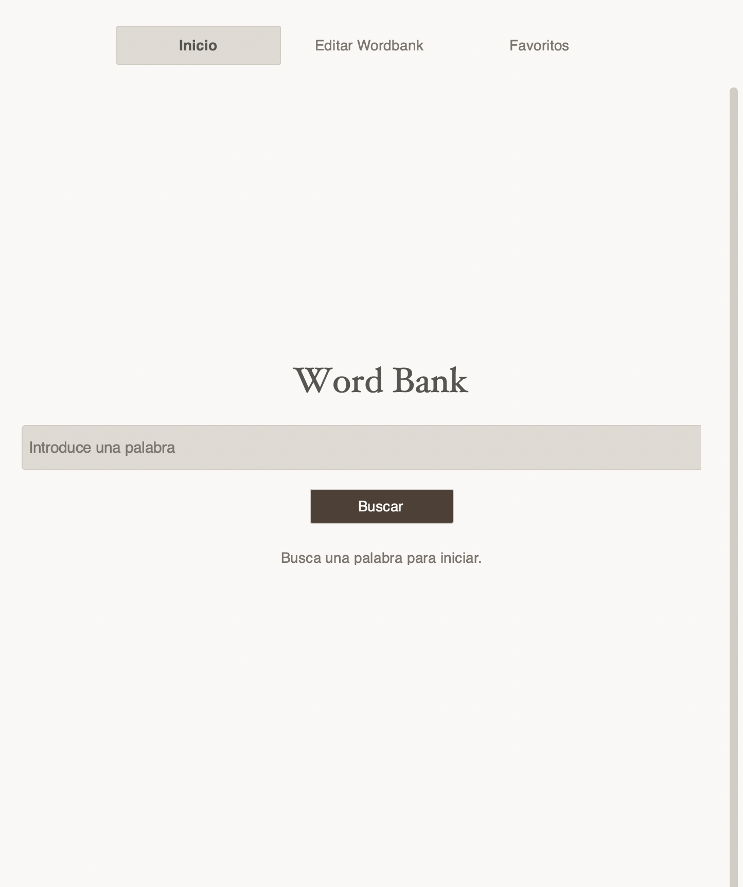
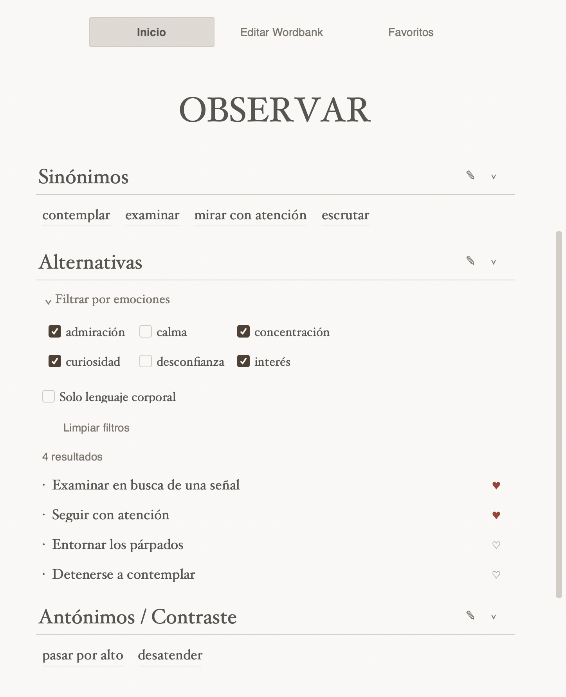
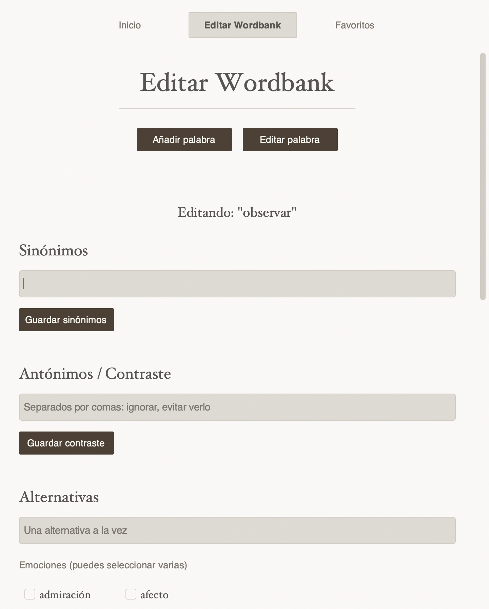
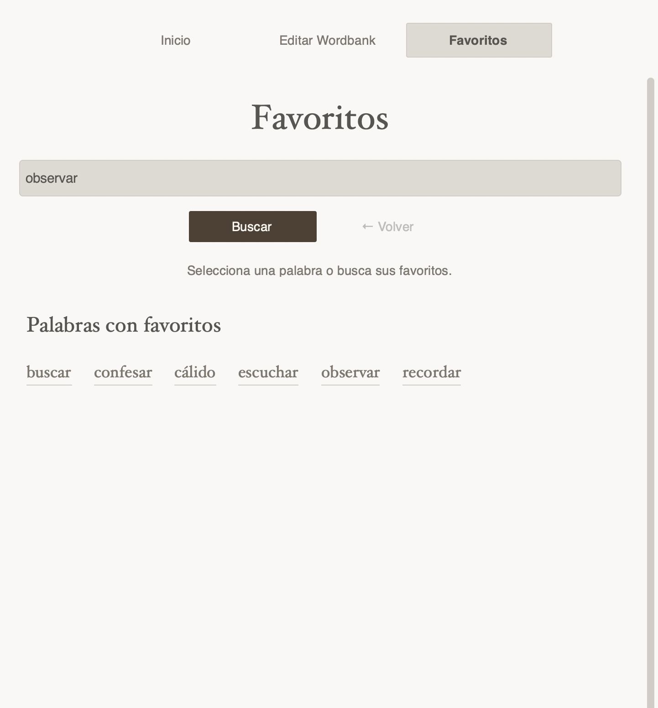

# Word Bank

A local creative-writing word bank built with Python and CustomTkinter.

Word Bank helps organize Spanish vocabulary for fiction writing through synonyms, alternative phrasings, contrast terms, emotion tags, and body-language cues. It includes both a desktop GUI and a terminal interface, with all user data stored locally in JSON.

## Features

- Search words and browse their synonyms, alternatives, and contrast terms
- Follow clickable synonyms that have their own entries
- Filter alternative phrasings by emotion and body language
- Favorite useful alternatives and view favorites first
- Add, edit, and delete entries
- Prevent duplicate words and repeated entries
- Save all changes locally without an account or cloud service
- Use either a CustomTkinter desktop interface or a terminal interface

Favorites currently apply to alternative phrasings.

## Requirements

- Python 3.10+
- Tkinter
- CustomTkinter

Install Python dependencies with:

```sh
python -m pip install -r requirements.txt
```

You can check whether Tkinter is available with:

```sh
python -m tkinter
```

On some Linux systems, Tkinter may need to be installed separately through the operating system package manager.

## Installation

Clone the repository and open a terminal inside the project folder:

```sh
git clone <repository-url>
cd wordbank
```

Create and activate a virtual environment:

```sh
python3 -m venv .venv
source .venv/bin/activate
```

On Windows PowerShell:

```powershell
py -m venv .venv
.venv\Scripts\Activate.ps1
```

Install the required package:

```sh
python -m pip install -r requirements.txt
```

## Run

### Desktop interface

```sh
python gui.py
```

### Terminal interface

```sh
python main.py
```

The GUI includes search, filtering, favorites, inline editing, deletion, and word management.

The terminal interface provides the main word-bank functionality through text-based menus.

## Starter data

The repository includes `wordbank_default.json`, a starter catalog containing 50 Spanish entries with:

- synonyms
- alternative phrasings
- contrast terms
- emotion tags
- body-language labels
- sample favorites

The starter catalog is meant to demonstrate the app and provide a useful starting point for creative writing.

These entries are contextual writing suggestions rather than interchangeable dictionary definitions.

## Local data

On first run, if `wordbank.json` does not exist, the application creates a personal copy using `wordbank_default.json`.

After that:

- all edits are saved to `wordbank.json`
- the default catalog remains unchanged
- an existing `wordbank.json` is never automatically overwritten
- personal data is excluded from Git through `.gitignore`

This keeps the published starter dataset separate from each user's personal word bank.

## Backups

To back up your data:

1. Close the application.
2. Copy `wordbank.json` to a safe location.

To restore a backup, close the application and replace the current `wordbank.json` with your saved copy.

The application currently stores data locally only and does not provide cloud synchronization.

## Platform notes

Word Bank has primarily been developed and tested on macOS.

Windows and Linux may use different fonts or require additional Tkinter setup.

## Screenshots

### Home
A clean starting view for searching and exploring the word bank.



### Word view and filters
Browse synonyms, alternative phrasings, emotion filters, body-language options, favorites, and contrast terms.



### Edit Wordbank
Add or update synonyms, contrast terms, alternatives, emotion tags, and body-language information.



### Favorites
Browse words with saved favorite alternatives and quickly return to useful writing phrases.

